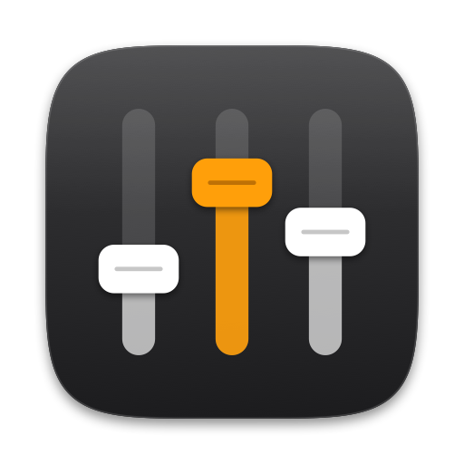

<p align="center"></p>

<h1 align="center">Hush</h1>

<p align="center">Per-app volume control for macOS, in your menu bar.</p>

<p align="center">
  <a href="https://github.com/aydenjahola/Hush/actions/workflows/ci.yml"></a>
  <a href="https://github.com/aydenjahola/Hush/releases/latest"></a>
  <a href="https://github.com/aydenjahola/Hush/blob/main/LICENSE"></a>
</p>

Turn Spotify down, boost a quiet call, mute a noisy tab: Hush gives every app that's playing audio its own fader, mute button and level meter. It uses Core Audio process taps, so there's **no audio driver to install** and no admin password.

**[Download the latest release](https://github.com/aydenjahola/Hush/releases/latest)** · macOS 26 or later · **[Website and documentation](https://aydenjahola.github.io/Hush/)**

The documentation covers [installing](https://aydenjahola.github.io/Hush/getting-started/install/) (including uninstalling), [using the mixer](https://aydenjahola.github.io/Hush/using/mixer/), [settings](https://aydenjahola.github.io/Hush/using/settings/), [troubleshooting](https://aydenjahola.github.io/Hush/help/troubleshooting/), [building from source](https://aydenjahola.github.io/Hush/contributing/build-from-source/), [releasing](https://aydenjahola.github.io/Hush/contributing/releasing/) and [how Hush works](https://aydenjahola.github.io/Hush/contributing/architecture/). The essentials are below.

<!-- Screenshots: replace each comment with a real capture once it exists.
<p align="center"></p>
<p align="center"></p>
<p align="center"></p>
-->

## Features

- **A fader per app**, from silent up to 200% boost, with a soft limiter so boosted audio doesn't clip harshly
- **Mute** any app with one click
- **Live level meters**, which you can turn off
- **Three layouts:** channel strips (scroll a fader to change it), Control Center-style classic rows, or tiles you drag anywhere (in rows and tiles, scroll scrolls the list; hold Option to scroll the volume)
- **Appearance options:** comfortable or compact size, percentages on or off, playing-first or alphabetical order, amber or your system accent colour for the fills (boost is always amber), and a speaker or fader-glyph menu bar icon
- **Remembers** each app's level across restarts
- Apps you haven't touched aren't processed at all (except to measure them for the level meters while the mixer is open, if meters are on)
- **Follows your output device** when you switch headphones or speakers
- **Tells you when a new version is available**
- **No driver, no admin password**

## Privacy

Hush doesn't collect or send any data about you or your audio. The only network request it makes is the update check: about 30 seconds after launch and then once a day, it asks GitHub's public API for the latest Hush release. The request carries only a generic `Hush/<version>` user agent and standard HTTP headers (`Accept`, `Accept-Language: en`, the GitHub API version, and an `If-None-Match` tag so an unchanged answer costs almost nothing), with no cookies, accounts or other identifiers. If a check fails, Hush retries after 1 hour, then 4 hours, then daily. When a newer version exists, Hush shows a banner in the popover, a dot on the menu bar icon and a notification. **Download** opens the release in your browser; Hush never downloads or installs anything itself. Turn the check off in Settings → "Check for updates automatically".

## Requirements

- macOS 26 or later
- Audio Recording permission (Hush asks on first launch)

## Install

Full guide: [Install Hush](https://aydenjahola.github.io/Hush/getting-started/install/).

1. Download `Hush.dmg` from the [latest release](https://github.com/aydenjahola/Hush/releases/latest).
2. Open it and drag **Hush** onto **Applications**.
3. Open Hush from Applications. macOS blocks it the first time, because Hush isn't signed with a paid Apple Developer ID: it's free and open source, so releases are ad-hoc signed. To allow it, either:
   - open **System Settings → Privacy & Security**, scroll down to the message about Hush, click **Open Anyway** and confirm; or
   - run `xattr -dr com.apple.quarantine /Applications/Hush.app` in Terminal.

   Since macOS 15, right-click → Open no longer bypasses this check.
4. Grant Audio Recording permission when Hush asks.

Each DMG has a matching `.sha256` file (`Hush.dmg.sha256`, `Hush-x.y.z.dmg.sha256`). To check your download, put the `.sha256` file in the same folder as the DMG and run `shasum -a 256 -c Hush.dmg.sha256` there (or the versioned name, to match the DMG you downloaded).

## Uninstall

Also in the [install guide](https://aydenjahola.github.io/Hush/getting-started/install/#uninstall-hush).

1. If you turned on "Launch at login", turn it off in Hush's Settings, or remove Hush from System Settings → General → Login Items.
2. Quit Hush (right-click the gear in the popover → Quit Hush).
3. Delete `/Applications/Hush.app`.
4. Remove its saved levels: `rm -r ~/Library/Application\ Support/Hush`
5. Reset its Audio Recording permission: `tccutil reset AudioCapture io.github.aydenjahola.Hush`

## Build from source

Full guide: [Build from source](https://aydenjahola.github.io/Hush/contributing/build-from-source/).

Building from source needs **Xcode 26 or later**; the Command Line Tools alone aren't enough. (To just use Hush, download the DMG above: you don't need Xcode.) Select Xcode once:

```sh
sudo xcode-select -s /Applications/Xcode.app/Contents/Developer
```

or set `DEVELOPER_DIR=/Applications/Xcode.app/Contents/Developer` for a single command. The Makefile stops with a clear message if neither points into an Xcode app.

```sh
make test     # run the unit tests
make integration-test  # real Core Audio tests (needs Audio Recording permission; see the testing guide)
make app      # build build/Hush.app (ad-hoc signed)
make run      # build and launch
make install  # build, quit Hush, replace /Applications/Hush.app and relaunch it
make dmg      # build build/Hush-<version>.dmg (add ARCHS="arm64 x86_64" for a universal binary)
make icon     # regenerate Resources/Hush.icns from scripts/make-icon.swift
```

Run `Hush.app` (via `make run`), not the bare binary from Xcode's Run button. Without the app bundle there's no bundle ID or Audio Recording usage description, so the permission prompt and the Settings window misbehave.

Rebuilding changes the ad-hoc signature, so macOS may ask for Audio Recording permission again.

`make install` builds first, so a failed build leaves your installed copy alone. It accepts `ARCHS` like `make app` (e.g. `make install ARCHS="arm64 x86_64"`).

## How it works

For each app you adjust, Hush creates a private process tap that mutes the app at the source, then plays the tapped audio back through a private aggregate device with your gain applied. Muting is the same with the gain at zero. Muted, lowered or boosted apps are processed only while they play, so an idle app costs nothing. Apps left at 100% are untouched. If Hush quits or crashes, macOS removes its taps and every app plays normally again.

## Known limitations

- For muted, lowered or boosted apps, up to about a second (usually much less) of each new sound can play at normal volume before Hush notices it and starts processing it. This includes a muted app's notification sounds, and the first sound after an app launches or starts a new audio helper process (common in browsers).
- Audio from command-line tools is attributed to the terminal app that launched them.
- When you switch output devices, muted, lowered or boosted apps briefly play at their normal level while Hush rebuilds their engines.
- When Hush starts adjusting an app that's already playing, there can be a tiny (~10 ms) dropout at that moment. Core Audio drops one buffer of the app's audio when Hush takes it over.

## Releasing

Releases are automated with [release-please](https://github.com/googleapis/release-please):

1. Write [Conventional Commits](https://www.conventionalcommits.org/) (`feat:`, `fix:`, …) on `main`.
2. release-please keeps a release PR open that bumps `version.txt` and updates `CHANGELOG.md`.
3. Merge the release PR. release-please tags `vX.Y.Z` and creates the GitHub release.
4. The same workflow (`.github/workflows/release.yml`) then runs the tests, builds a universal DMG and uploads `Hush-X.Y.Z.dmg`, `Hush.dmg` and a `.sha256` checksum for each to the release.

The first release is pinned with `"release-as": "0.1.0"` in `release-please-config.json` so it matches `version.txt`. **Remove that line after 0.1.0 ships**, or every later release PR will propose 0.1.0 again.

The repository needs Settings → Actions → General → "Allow GitHub Actions to create and approve pull requests" turned on so release-please can open its PR. Releases are ad-hoc signed. If the `MACOS_CERT_P12_BASE64`, `MACOS_CERT_PASSWORD`, `NOTARY_APPLE_ID`, `NOTARY_TEAM_ID` and `NOTARY_PASSWORD` secrets are ever added, the workflow signs with the Developer ID and notarizes too. Before merging a release PR, run through the [manual checklist](https://aydenjahola.github.io/Hush/contributing/testing/#manual-checklist). The full release guide is [on the website](https://aydenjahola.github.io/Hush/contributing/releasing/).

## Contributing

See [CONTRIBUTING.md](CONTRIBUTING.md). Any change to audio behaviour (engines, taps, the process monitor, how the mixer starts or swaps engines) must pass `make integration-test` before it merges, not just `make test`: the unit tests use fake engines and can't see what reaches the speakers. CI runs the integration tests only experimentally, so run them on your Mac and say so in the pull request. Setup (BlackHole 2ch and the Audio Recording permission) is in the [testing guide](https://aydenjahola.github.io/Hush/contributing/testing/#integration-tests).

## License

Hush is free software, licensed under the [GNU General Public License v3.0](LICENSE).
